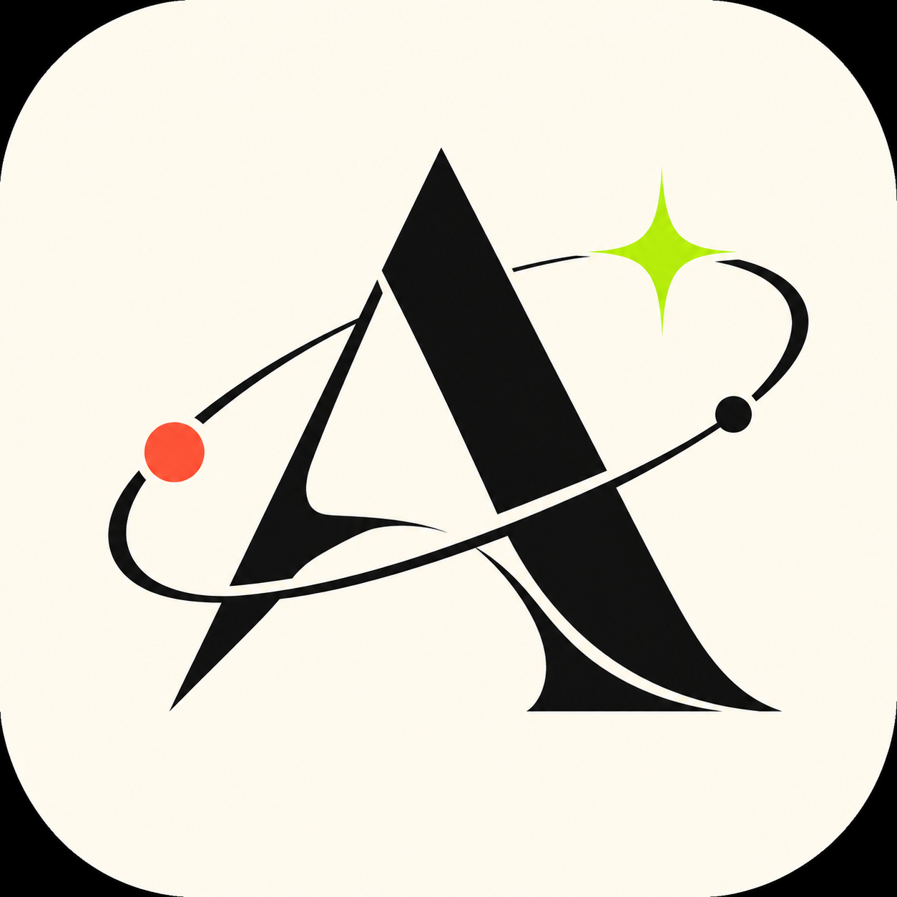

# Credential Constellation

**Learning, mapped.** A personal archive by Anuj Mhatre, bringing certificates, badges, and learning milestones out of folders and into one searchable collection.

[Explore the live archive](https://credential-constellation.vercel.app/) · [Portfolio](https://anujmhatre.me) · [LinkedIn](https://linkedin.com/in/anuj-mhatre-031807ma)

## About

Credential Constellation combines a credential gallery with an inventory of installed Codex workflows. It is a static, single-page website built with HTML, CSS, and vanilla JavaScript: no framework, database, package installation, or build step is required to run it locally.

The visual identity borrows from experimental editorial typography: warm paper, near-black ink, orange and lime accents, oversized Syne lettering, DM Mono labels, orbital linework, and sharp ruled grids.

## Features

- **Searchable credentials:** search by title or provider, and filter certificates, badges, or milestones.
- **Full-size previews:** open a credential in a native dialog, then follow its full-image link for closer inspection.
- **Responsive gallery:** a three-column collection on desktop and two columns on smaller screens.
- **Learning terrain:** four curated areas covering Generative AI, Claude & MCP, Data Science, and IBM Granite.
- **Codex workflow atlas:** search installed workflows, filter their source collections, and follow repository links where available.
- **Considered motion:** staggered card entrances and hover feedback, with reduced-motion preferences respected.

## Collection at a glance

Snapshot of the checked-in collection, **22 October 2026**:

| Record type | Count |
| --- | ---: |
| Certificates | 25 |
| Badges | 5 |
| Milestone stickers | 3 |
| **Total credentials** | **33** |

The collection uses **9 provider labels**, including Anthropic, Google, IBM, IBM Career Education Program, AWS Training & Certification, AWS Builder Center, GitHub / Microsoft, Oracle University, and Cisco Networking Academy.

Recent additions include **GitHub Foundations**, **Java Certified Foundations Associate**, and **JavaScript Essentials 1**.

The separate [Codex inventory](public/codex-installed-skills.md) contains **471 installed workflows across 49 source collections**. These numbers describe the tooling setup, not personal certifications or independently assessed proficiency. Credential records also distinguish course completion, exam preparation, and event participation; they should not be read as equivalent qualifications.

## Run locally

Prerequisites: Git and a current supported Node.js release. Use a modern browser with JavaScript enabled.

```powershell
git clone https://github.com/mhatreanuj57-alt/credential-constellation.git
cd credential-constellation
node scripts/server.mjs
```

Open **http://127.0.0.1:4173/**. Stop the server with **Ctrl+C**.

There is no `npm install` or `npm run build` step. Run the server from the repository root; it serves the `public/` directory. Use the local HTTP server instead of opening `index.html` directly, because the workflow atlas fetches its Markdown inventory.

Google Fonts and the GitHub-hosted profile avatar require an internet connection. Credential images and the workflow inventory are served from this repository. The included Node server is intended for local preview, not production hosting.

## Project structure

```text
credential-constellation/
├── public/
│   ├── index.html                 # Page, credential data, and browser interactions
│   ├── styles.css                 # Editorial theme, responsive rules, and motion
│   ├── favicon.png                # Orbital A emblem
│   ├── codex-installed-skills.md   # Workflow inventory loaded by the page
│   └── assets/credentials/        # Certificate, badge, and milestone images
├── scripts/server.mjs             # Dependency-free local preview server
├── docs/                          # Project notes and earlier planning documents
├── vercel.json                    # Publishes public/ as the output directory
├── .vercelignore                  # Excludes local launch-video output folders
└── LICENSE
```

## Add a credential

1. Export a readable image of the certificate or badge and place it in `public/assets/credentials/`. Keep the original document separately and check for information you do not want published.
2. Add an entry to the `credentials` array in `public/index.html`, following the existing order: title, provider, type, image filename. Supported types are `certificate`, `badge`, and `sticker`. Keep metadata as trusted plain text.
3. Update the static totals in the hero orbit, collection statistics, filter buttons, and initial results text. Change the provider count only when introducing a distinct provider label.
4. Update this README's collection snapshot. The four learning paths are separate curated content; their count does not increase automatically with each credential.
5. Run locally and check search, filtering, the full-size preview, and a narrow viewport before publishing.

For workflow updates, preserve the existing `## owner/repository (count)` headings and `- skill-name` entries in `public/codex-installed-skills.md`. The page calculates workflow and source totals from that file; update the static heading and fallback numbers in `public/index.html` when the inventory changes.

## Deploy

The site is deployed on **Vercel**. The checked-in [configuration](vercel.json) sets the output directory to `public`; there is no application build command.

With the Vercel CLI installed and authenticated, run from the repository root:

```powershell
vercel --prod
```

On an existing checkout, confirm that it is linked to the intended Vercel project. On a fresh clone, select or link the project when prompted. Keep `.vercelignore` in place so local video-render folders are not uploaded.

After deployment, check the live collection count and open each newly added credential. A GitHub push and a Vercel deployment are separate operations unless Git integration has been configured.

## Author and license

Created by **Anuj Mhatre**. This repository is maintained at [mhatreanuj57-alt/credential-constellation](https://github.com/mhatreanuj57-alt/credential-constellation); the website retains its original `a18-n03` identity links.

The project code is distributed under the [MIT License](LICENSE). Certificate artwork, issuer logos, and provider names remain associated with their respective owners; their inclusion does not imply endorsement of this project.
